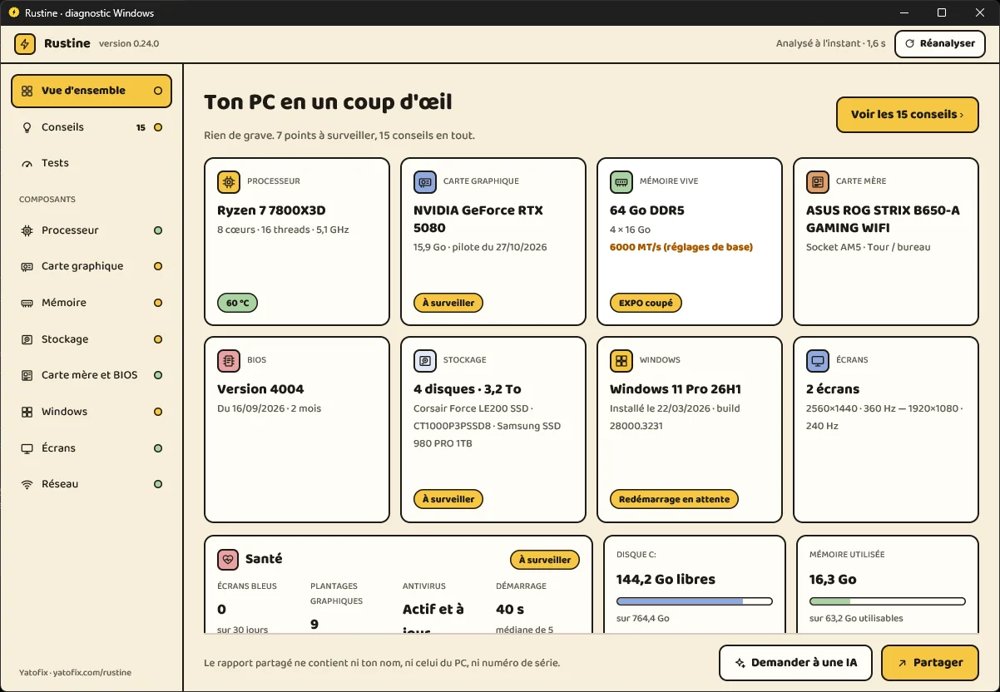
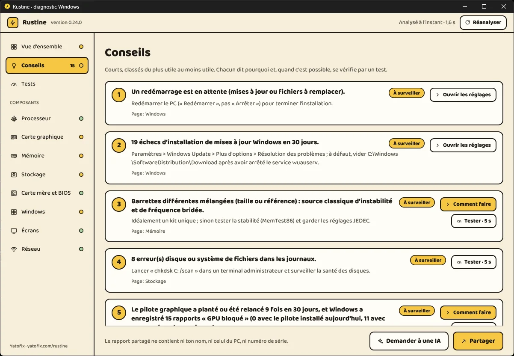
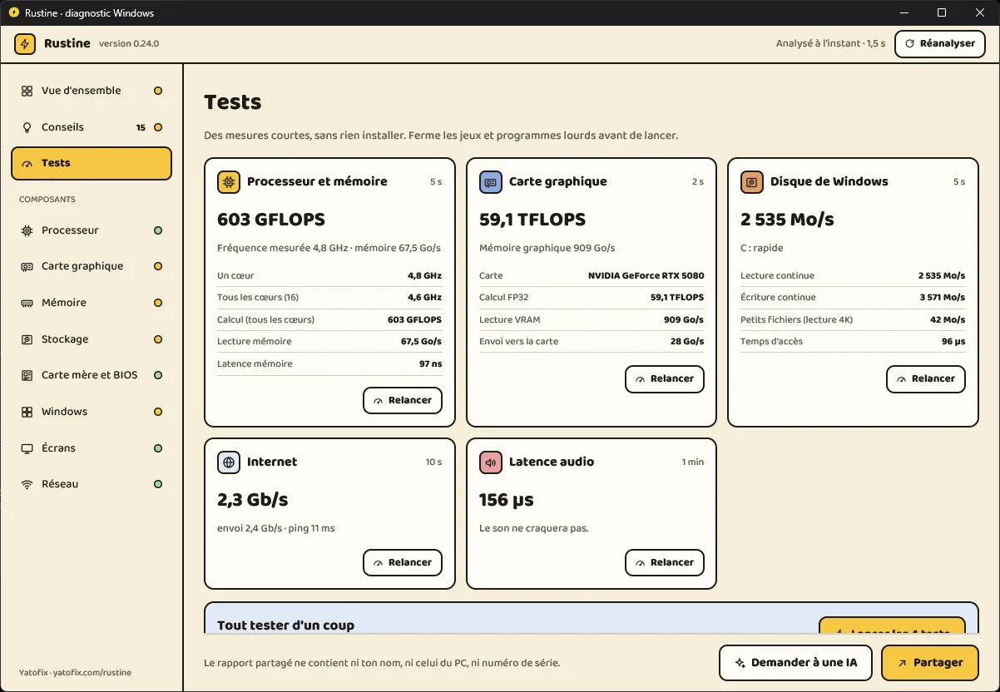
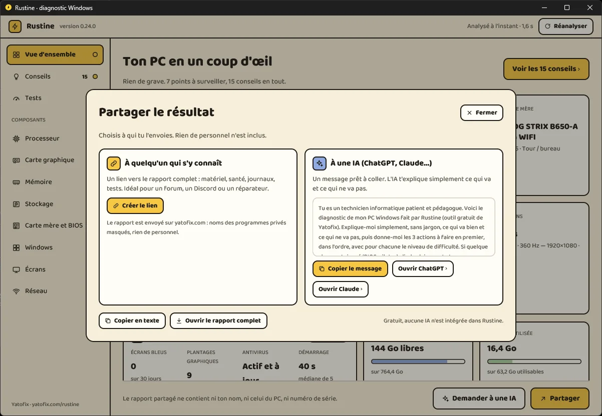

<p align="center">
  
</p>

<h1 align="center">Rustine</h1>

<p align="center">
  Le diagnostic gratuit de votre PC Windows : tout le matériel d'un coup d'œil, des conseils clairs, des tests en un clic.<br>
  Un seul fichier, sans installation, sans publicité, sans abonnement.
</p>

<p align="center">
  <a href="https://github.com/samirmedani/rustine/releases/latest/download/Rustine.exe"><b>Télécharger Rustine.exe</b></a>
  &nbsp;·&nbsp;
  <a href="https://yatofix.com/rustine">Page officielle</a>
  &nbsp;·&nbsp;
  <a href="https://github.com/samirmedani/rustine/releases">Toutes les versions</a>
</p>

<p align="center">
  
</p>

---

Vous ouvrez Rustine, et deux secondes plus tard tout votre PC est là, rangé : processeur, carte graphique, mémoire, carte mère, version et date du BIOS, disques, Windows et sa date d'installation, écrans. Chaque case a une pastille verte, jaune ou rose ; un clic ouvre le détail du composant.

Rustine est écrit en Rust. Le moteur de diagnostic tourne sans bibliothèque standard, avec de l'assembleur là où chaque cycle compte, et lit les sources à la racine (SMBIOS, SMART et NVMe, journaux de Windows, vidages d'écran bleu) sans WMI ni PowerShell : l'inventaire complet prend moins d'un dixième de seconde. La fenêtre est dessinée par la carte graphique avec GPUI, le moteur d'interface de l'éditeur Zed. Le tout tient dans un fichier d'environ 10 Mo, cinq fois moins que UserDiag (57 Mo).

## Ce que Rustine montre

| | |
| --- | --- |
| **Vue d'ensemble** | Une case par composant, son modèle, l'essentiel et son état. La santé (écrans bleus, plantages graphiques, antivirus, durée du démarrage), la place sur le disque de Windows et la mémoire utilisée. |
| **Carte mère et BIOS** | Modèle, format, version et date du BIOS (avec son âge), UEFI et Secure Boot. |
| **Mémoire** | Barrettes, canaux, fréquence réelle, profil XMP/EXPO coupé, kits mélangés, où passe la RAM. |
| **Stockage** | SMART et journal NVMe : usure, secteurs défectueux, température, place libre. |
| **Carte graphique et écrans** | Pilote et sa date, plantages, port PCIe bridé, écran réglé sous sa fréquence maximale. |
| **Windows** | Mises à jour en échec, redémarrage en attente, sécurité, démarrage lent, ce qui se lance en douce. |
| **Réseau** | Lien Ethernet bloqué à 100 Mb/s, Wi-Fi faible, pertes de paquets. |

## Conseils

Les constats de Rustine, courts et classés du plus utile au moins utile : ce qui ne va pas, pourquoi, et quoi faire. Quand c'est possible, un tuto pas à pas (BIOS, pilote, matériel) ou le test qui vérifie. Ce qui est souvent voulu ou normal est rangé à part, dans « Bon à savoir ».

<p align="center"></p>

## Tests en un clic

| Test | Durée | Mesure |
| --- | --- | --- |
| Processeur et mémoire | ~5 s | Fréquence réelle, calcul sur tous les cœurs, débit et latence de la mémoire. |
| Carte graphique | ~2 s | Calcul FP32, lecture de la mémoire vidéo, transferts PCIe. |
| Disque de Windows | ~5 s | Lecture et écriture continues, petits fichiers, temps d'accès. |
| Internet | ~10 s | Débit descendant et montant, ping (serveurs publics de Cloudflare). |
| Latence audio | 1 min | Les pilotes qui font craquer le son et saccader les jeux, comme LatencyMon. |

<p align="center"></p>

## Partager pour se faire aider

Le bouton **Partager**, en bas à droite :

- **À quelqu'un qui s'y connaît** : un lien vers le rapport complet, pour un forum, un Discord ou un réparateur. Les noms des programmes privés sont masqués.
- **À une IA** : un message prêt à coller dans ChatGPT ou Claude, qui vous explique simplement ce qui va et ce qui ne va pas, et quoi faire en premier. Rustine n'intègre aucune IA et n'envoie rien à une IA : c'est vous qui collez le message.
- **Copier en texte** ou **ouvrir le rapport complet** (HTML, gardé sur votre PC).

<p align="center"></p>

## Vos données

Aucun numéro de série, nom de machine ni nom d'utilisateur n'est collecté, et les chemins de votre profil sont masqués. L'analyse reste sur votre PC : le rapport n'est envoyé sur yatofix.com que si vous cliquez sur « Partager », puis « Créer le lien ». Il est supprimé au bout de 180 jours, et votre rapport local contient un lien pour le supprimer vous-même.

Rustine n'installe rien. En ligne de commande seulement, `--pilote` installe le pilote signé [PawnIO](https://pawnio.eu) pour les températures du processeur.

## Mises à jour

Connecté à Internet, Rustine regarde ici s'il existe une version plus récente ; si oui, un bouton **Mettre à jour** apparaît en haut à droite. Rustine télécharge alors `Rustine-<version>.exe` de la dernière release, **vérifie son empreinte SHA-256**, remplace l'ancien fichier et se relance. Rien n'est envoyé pour cela : Rustine lit seulement `latest.txt` dans ce dépôt. En ligne de commande : `--chercher-mise-a-jour` et `--mettre-a-jour`.

## Premier lancement : l'avertissement de Windows

Rustine n'est pas signé avec un certificat payant, donc Windows affichera probablement « Windows a protégé votre ordinateur ».

1. Dans le navigateur, choisissez **Conserver** si on vous le demande.
2. Sur l'écran SmartScreen, cliquez sur **Informations complémentaires**, puis **Exécuter quand même**.

Chaque version est analysée par Microsoft Defender avant sa mise en ligne. Vous pouvez vérifier votre fichier avec son empreinte SHA-256, publiée dans chaque [release](https://github.com/samirmedani/rustine/releases) :

```powershell
Get-FileHash .\Rustine.exe -Algorithm SHA256
```

## Configuration

Windows 11, 64 bits. Windows 10 peut fonctionner, sans garantie. Les droits administrateur sont demandés au lancement pour lire la santé des disques et les écrans bleus ; vous pouvez refuser, l'analyse continue en mode limité.

## Ligne de commande

Depuis un terminal (ou avec `--console`), Rustine répond en texte, sans fenêtre. Les anciens modes y restent disponibles.

| Option | Effet |
| --- | --- |
| `--sans-test` · `--rapide` · `--complet` · `--long` | Choisit la formule du diagnostic. |
| `--memoire` | Analyse de la mémoire (60 s de surveillance des fuites). |
| `--latence` | Latence audio : 2 minutes de mesure des pilotes. |
| `--plante` · `--demarrage` · `--lent` · `--jeu` · `--peripherique` | Diagnostic centré sur un souci. |
| `--extreme` | Mode Extrême : chaque composant au maximum, avec un score. |
| `--reparer` · `--annuler-reparation` | Réparation de ce qui est coché d'office, point de restauration compris ; puis retour en arrière. |
| `--hors-ligne` | Aucun envoi, aucun accès Internet. |
| `--no-open` | N'ouvre pas le rapport dans le navigateur. |
| `--sans-admin` | Pas de demande de droits administrateur. |
| `--chercher-mise-a-jour` · `--mettre-a-jour` | Vérifie, ou installe, la dernière version publiée ici. |

## Bugs et idées

Ouvrez une [issue](https://github.com/samirmedani/rustine/issues) avec votre version de Windows et, si possible, le lien de votre rapport.

---

Rustine est gratuit et développé sur mon temps libre, édité par [Yatofix](https://yatofix.com). Le code source n'est pas publié ; le logiciel est distribué gratuitement, tous droits réservés.
